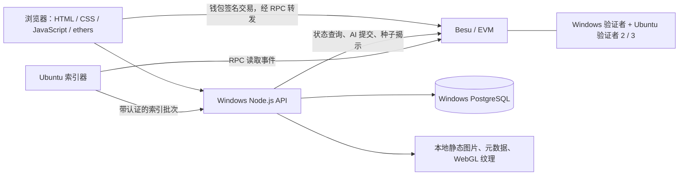

# 架构与区块链边界

## 运行结构

浏览器访问同一个游戏 API；房间列表由对战合约查询与双版本路由合并提供。外部电脑只同步区块，不会自动得到游戏网页、数据库或验证者资格。网页经 SSH 隧道访问原 Windows 的 `localhost:8787`，因此同源图片与卡面由同一 API 提供，不依赖外部节点本机另存一套图。

## 分层职责

| 层 | 语言 / 技术 | 主要文件 | 权威数据 |
|---|---|---|---|
| 展示 | HTML、CSS、浏览器 JavaScript、WebGL | `web/app.js`、`style.css`、`card-motion.mjs`、`market.mjs` | 仅渲染与操作输入 |
| 服务 | Node.js ES Modules、HTTP、ethers、pg | `server.mjs`、`lib/chain.mjs`、`lib/battle-chain.mjs` | 会话、配装、请求适配 |
| 合约 | Solidity 0.8.30、OpenZeppelin、EVM | `contracts/*.sol` | 铸造状态、所有权、交易、战斗状态与胜负 |
| 索引 | Node.js、SQL | `indexer.mjs`、`schema.sql` | 可重建的资产事件索引；业务偏好另存 |
| 共识 | Besu QBFT、点对点网络 | `adaptive-node/`、生成的节点 TOML | 已确认的链上状态与顺序 |

## 一次玩家行动如何执行

1. 浏览器选择角色和目标，提交行动参数。
2. API 识别对局所属合约，构建交易请求，不自行决定最终伤害。
3. 钱包检查允许的合约地址并签名，交易通过受限 RPC 转发进入链。
4. `TalosBattle.act` 校验参与者、`expectedSeq`、行动顺序和资源；固定链接的规则库执行结算。
5. 合约记录状态，发出 `ActionAccepted`、伤害/效果事件和必要的 `MatchFinished`。
6. API 读取新状态、重建日志，浏览器更新血条、护盾和动画。

旧的 `engine.cjs` / `web/engine.js` 仍用于兼容、客户端规则展示和 AI 行动选择，不能覆盖合约的最终判定。AI 由项目方 `aiOperator` 提交，也必须通过相同行动校验。链上确认延迟取决于共识，不能保证所有动作始终固定 3–5 秒。

## 值得汇报的小设计

- **凭证与可交易卡分开：** 原 ERC-1155 不转让，ERC-721 用 materialized 计数按原持有者登记，避免同一凭证在转赠后被重复兑换。
- **16 位编号：** 品质 1 位 + 角色 3 位 + 哈希派生随机段 8 位 + 前 12 位 Keccak 校验后 4 位；冲突检测后重试。它不是加密或 VRF，真正唯一身份是 `chainId + ERC721 合约 + tokenId`。
- **挂单版本号：** 购买携带卖家、价格和 revision，防止界面陈旧时按被修改的挂单误买；转移卡牌会清除挂单。
- **提取式付款：** 卖家收益记入 proceeds，单独提现；减少购买阶段向卖家外部转账带来的影响。
- **数值与外观隔离：** 稀有度影响图与边框，不影响攻击力、血量和技能强度。
- **不可变规则并行：** 新增 20 费实例，旧 16 费实例保留。对局永久绑定原地址，非代理升级，无需迁移已有 NFT。
- **公开牌局：** 手牌、抽牌顺序和战斗状态公开可核验，明确放弃服务器保密假设。
- **图片不上链：** 主链记录资产及规则，图片独立保存。这样更省链存储，但图片持久可用仍依赖部署者，没有使用 IPFS 保证可用性。

## 局限

这是使用区块链承载关键业务的混合架构。验证者、应用入口、种子、奖励签名和 AI 均由同一项目管理；未部署去中心化治理或密码学隐藏手牌。种子承诺只能约束已承诺值，服务方仍可选择不揭示，超时退款并不能消除所有偏差。3 个 QBFT 验证者不具备 4 节点网络容忍 1 个拜占庭故障的冗余；不应把“有三个节点”表述为“可容忍任意一个恶意节点”。

代码公开便于复核，不等于已通过独立安全审计。此系统适合低频回合制教学，不是高频动作游戏的实时全链方案。
